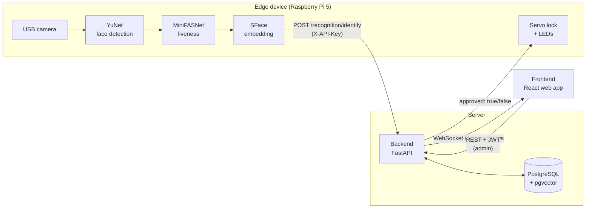

# The Smart Access

A proof-of-concept access control system that uses face verification to let people through a gate.
A camera on a Raspberry Pi finds the face, checks that it is a live person, and turns it into a face
embedding. The backend compares the embedding with enrolled people and decides whether the gate opens.

The project was developed by students at Mid Sweden University (course SIMS 2026) in
collaboration with SSG Standard Solutions Group. It is a prototype for demonstrating and
evaluating the approach. It is not a production-ready security system (see
[Known limitations](#known-limitations)).

## How it works



1. The **edge device** runs a loop: read a frame, detect the face, check liveness, compute a
   128-dimensional embedding and send it to the backend. Only the embedding leaves the device,
   never the image.
2. The **backend** finds the closest enrolled person in the database (cosine similarity with
   pgvector) and approves the attempt if the similarity is at least `0.363`. Approved attempts are logged.
3. The edge device opens the servo lock and lights the green LED when approved, and blinks
   the red LED when denied.
4. The **frontend** shows each result live on an access screen and gives administrators a place to
   enroll people and view the access log.

## Repository layout

| Folder | What it is | README |
|---|---|---|
| [backend/](backend/) | FastAPI server: database, matching, admin API, WebSocket to the frontend. | [backend/README.md](backend/README.md) |
| [frontend/](frontend/) | React + TypeScript web app: access view and admin interface. | [frontend/README.md](frontend/README.md) |
| [edge-device/](edge-device/) | Raspberry Pi client: camera, face detection, liveness, embedding, lock and LEDs. | [edge-device/README.md](edge-device/README.md) |
| [model-evaluation/](model-evaluation/) | Offline tool to measure recognition accuracy on a test dataset. | [model-evaluation/README.md](model-evaluation/README.md) |

## Quick start

Everything can run on one computer for a demo. The edge device then runs without the servo and
LEDs (it prints what the lock would do instead).

| Part | Default address |
|---|---|
| Backend | `http://localhost:8000` (API docs at `/docs`) |
| Frontend | `http://localhost:5173` |
| Edge device | `http://localhost:8001` |

1. **Database**: start PostgreSQL with the pgvector extension, for example with Docker. See
   [backend/README.md](backend/README.md#1-database).
2. **Backend**: create `backend/.env` from [backend/.env.example](backend/.env.example), install
   the requirements and start it from the repository root:
   ```bash
   uvicorn backend.app.app:app --port 8000
   ```
3. **First admin**: create an admin account from the command line (the web app needs an existing admin):
   ```bash
   python -m backend.scripts.admin_init --name "Jane Doe" --username jane --image path/to/face.jpg
   ```
4. **Frontend**: `cd frontend && npm install && npm run dev`, then open `http://localhost:5173`.
   Press **Ctrl + Alt + A** on the start page to log in as admin and enroll people.
5. **Edge device**: create `edge-device/.env` from [edge-device/.env.example](edge-device/.env.example)
   (same `DEVICE_API_KEY` as the backend) and start it from the `edge-device/` folder:
   ```bash
   uvicorn main:app --port 8001
   ```

Each README has the details for its part.

> **Note on secrets:** earlier versions of this repository had `.env` files with real keys and a
> database password committed. They have been removed from the repository but remain in the git
> history. Treat them as public and generate new values for every installation.

## Configuration overview

| Setting | Where |
|---|---|
| Database URL, JWT secret, device API key | `backend/.env` |
| Match threshold (`0.363`, the SFace default) | `OPENCV_REC_THRESHHOLD` in [backend/services/comparison_services.py](backend/services/comparison_services.py) |
| Allowed frontend origin (CORS) | [backend/app/app.py](backend/app/app.py) |
| Backend address used by the frontend | `BACKEND_URL` in [frontend/src/auth.ts](frontend/src/auth.ts) and the WebSocket URL in [frontend/src/pages/Home/components/Recognition.tsx](frontend/src/pages/Home/components/Recognition.tsx) |
| Device ID, backend URL, API key | `edge-device/.env` |
| Camera, detection, liveness, timing, GPIO pins, real/fake lock | [edge-device/config/config.py](edge-device/config/config.py) |

## Evaluation results

Summary from the project report. The full method and results are in the report.

| Measure | Result |
|---|---|
| Enrolled person correctly accepted (TAR), 1080 images | 75.1 % |
| Unknown person falsely accepted (FAR) | 2.6 % |
| Acceptance in front light vs. darkness | 99.7 % vs. 52.2 % |
| Liveness at threshold 0.5: attacks accepted (APCER) / real faces rejected (BPCER) | 44.1 % / 1.5 % |
| Response time, 50 granted attempts: median / 95th percentile / max | 0.34 s / 2.09 s / 3.36 s |

Lighting had the largest effect on recognition. The overall acceptance of 75.1 % is below the target
of about 80 % discussed with SSG, mostly because of the dark and back-lit conditions. The
response time target (under 5 s) was met. End-to-end tests showed that the
lock and LEDs responded correctly to the access decisions.

## Known limitations

This is a proof of concept. Before any real use, at least the following should be addressed:

- **`POST /auth/register` is not protected.** The frontend sends the admin token, but the backend
  does not check it, so anyone who can reach the backend can create an admin account. Add
  `dependencies=[Depends(verify_access_token)]` to the route in
  [backend/routes/admin_login_routes.py](backend/routes/admin_login_routes.py).
- **Access depends only on the face match.** An employee's `permission` (Standard/Admin/Limited)
  is stored and shown but not checked when deciding access, and there is no integration with
  SSG's training and certification data yet. That check belongs in `get_compare_response` in
  [backend/services/comparison_services.py](backend/services/comparison_services.py).
- **Addresses are hardcoded to `localhost`** in the frontend and in the backend's CORS setting,
  and there is no HTTPS. Change them before running the parts on separate machines.
- **Liveness detection is weak against attacks** (44 % of attack frames passed at the default
  threshold). Photos and phone screens can sometimes get through.
- **Lighting sensitivity**: recognition drops sharply in darkness and with back lighting, so camera
  placement and lighting at the gate matter.
- **Enrollment images are stored on the server.** Only embeddings are sent from the gate, but the
  photo used for enrollment is sent to and stored in the database.
- **Evaluated with one test subject.** The results should be repeated with more people, and with
  a gallery taken with the gate camera.
- **Leftover development code**: the backend has an unused `/camera/stream` route and test
  scripts in [backend/camera/](backend/camera/). The camera runs on the edge device.
- The servo is a demonstration of a lock. A real installation needs an industrial lock or gate
  controller and handling of power and network failures.

Suggested future work from the report: an industrial lock, alternative recognition models
(for example FaceNet512), and evaluation with more people.

## Authors

| Name | Main area |
|---|---|
| Fredrik Paulsson | Computer vision (face detection and feature extraction) |
| Shawal Basheer | Computer vision (liveness) |
| Pennie Hanson | Frontend |
| Vincent Sjöblom | Backend |
| Anders Lundgren | Backend |
| Bashar Marouf | Edge device and hardware |

Supervisors: Roger Olsson and Rikard Hamrin, Mid Sweden University.
